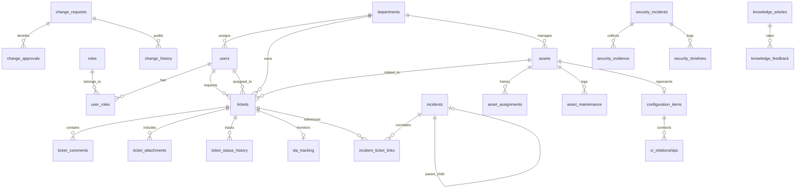

# Enterprise ITSM Architectural Specification

## 1. Architectural Philosophy

The **Enterprise ITSM Platform** is engineered following clean architecture and modular monolithic design principles. Rather than fragmenting operational domains into premature microservices with distributed latency and network failure modes, the system leverages cohesive Python modules with strictly bounded contexts:

- `core/`: Cross-cutting concerns (Security, Rate Limiting, RBAC permissions, Database session lifecycle).
- `models/`: Declarative SQLAlchemy 2.0 relational mappings with explicit foreign keys, indexes, and soft-delete scopes.
- `schemas/`: Pydantic V2 bidirectional serialization and validation contracts.
- `services/`: Business logic decoupling (SLA clock calculation, automation execution, telemetry generation).
- `api/v1/`: Versioned REST routers with standardized HTTP response status codes.

---

## 2. Database Schema Model (ERD)

---

## 3. Enterprise Security Matrix

| Security Layer | Implementation Mechanism | Purpose |
|---|---|---|
| **Password Hashing** | Argon2id (`argon2-cffi`) | State-of-the-art memory-hard hashing resistant to GPU cracking. |
| **Token Authentication** | PyJWT with RS256/HS256 | Stateless 60-minute access token lifespan. |
| **Refresh Rotation** | SHA-256 token hashing in DB | 7-day refresh token revoked upon single use; prevents token replay attacks. |
| **Account Lockout** | Failed attempt counter | 5 consecutive bad passwords lock account for 15 minutes. |
| **Resource Isolation** | `check_ticket_access` dependency | Prohibits employees from viewing or editing tickets submitted by other users. |
| **Hardened Headers** | Custom ASGI Middleware | `X-Content-Type-Options`, `X-Frame-Options: DENY`, `Strict-Transport-Security`, `CSP`. |
| **Rate Limiting** | Sliding window rate limiter | 120 requests/minute per client IP to mitigate denial-of-service attempts. |
| **Audit Trails** | `record_audit_log` service | Immutable recording of user, IP, action, and JSON state mutation diffs. |

---

## 4. SLA Calculation Engine

Deadlines are dynamically assigned at ticket creation based on service catalog and priority:

$$\text{Priority} = f(\text{Impact}, \text{Urgency})$$

| Priority | Target Response | Target Resolution | Business Hours Only |
|---|---|---|---|
| **CRITICAL (P1)** | 15 Minutes | 2 Hours (120 min) | False (24/7/365) |
| **HIGH (P2)** | 60 Minutes | 8 Hours (480 min) | True |
| **MEDIUM (P3)** | 4 Hours (240 min) | 24 Hours (1440 min) | True |
| **LOW (P4)** | 8 Hours (480 min) | 72 Hours (4320 min) | True |

When a ticket enters the `PENDING_USER` status, the resolution clock is paused. Upon resuming (`IN_PROGRESS`), the elapsed paused duration is calculated and added to the resolution deadline.
